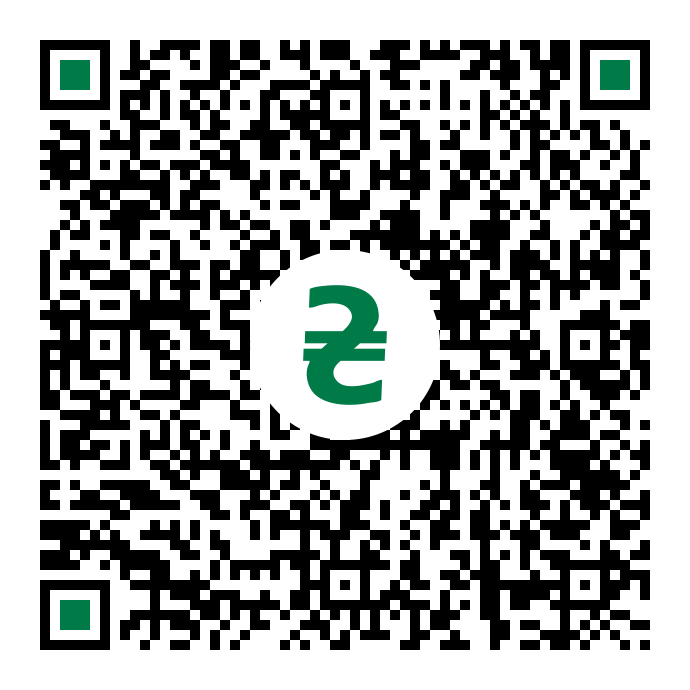

# NBUQRCode (Swift)

[](https://github.com/skules777/nbu-qr-code-swift/actions/workflows/swift.yml)
[](LICENSE)
[](https://swift.org/package-manager/)


Платіжні QR-коди НБУ для оплати за IBAN (формат 003,
[Постанова №97](https://bank.gov.ua/admin_uploads/law/19082025_97.pdf)).
Платник сканує код у застосунку свого банку — і отримувач, IBAN, ЄДРПОУ, сума
та призначення платежу заповнюються самі. А кнопки «Оплатити через …»
відкривають той самий платіж одразу в застосунку конкретного банку.

## Встановлення

Вимоги: iOS 15+ або macOS 12+, Swift 5.9+.

Swift Package Manager:

```swift
dependencies: [
    .package(url: "https://github.com/skules777/nbu-qr-code-swift", from: "1.0.1")
]
```

Або в Xcode: **File → Add Package Dependencies…** →
`https://github.com/skules777/nbu-qr-code-swift`.

Додайте до target потрібні модулі:

- **`NBUQRCode`** — платіж і посилання;
- **`NBUQRCodeImage`** — зображення QR-коду.

## Швидкий старт

<p align="center">
  
</p>

Цей QR-код згенеровано ось цим кодом:

```swift
import NBUQRCode
import NBUQRCodeImage

let payment = NBUQRPayment(
    recipient: "Петренко Роман Петрович",
    iban: "UA906543210000000260323012024",
    amount: 63,
    recipientCode: "40121425",
    purpose: "За каву"
)

let payload = try NBUQRPayload(payment)

let png = try NBUQRImageRenderer(accentColor: .nbuGreen).pngData(for: payload)
let monobank = payload.deepLink(for: .monobank)
```

Дані — з офіційного прикладу Постанови (P2P-переказ). Для `UIImage`
використовуйте `cgImage(for:)` замість `pngData(for:)`.

## Як це працює

У QR-коді — посилання `https://qr.bank.gov.ua/…`. Що відбувається далі,
залежить від того, чим його відкрити:

- **Сканер у застосунку банку** — реквізити заповнюються автоматично. Саме так
  радить НБУ:

  > **ВАЖЛИВО!** Для швидкої оплати наступного разу скануйте QR-код із
  > зображенням знаку гривні відразу із платіжного застосунку.
  >
  > — [bank.gov.ua/ua/qr](https://bank.gov.ua/ua/qr)

- **Камера iPhone** відкриває застосунок банку, який обробляв такий QR-код
  останнім.
- **Перехід за посиланням** відкриває один зі встановлених банківських
  застосунків — дати платнику вибір iOS не дозволяє.

Тому, щоб платник сам обрав банк, покажіть поруч із QR-кодом кнопки
«Оплатити через …» — див. [Банки](#банки).

QR-код з кодом старту застосунку конкретного банку (напр. monobank) бібліотека свідомо не
генерує: його опрацює лише застосунок цього банку, сканер будь-якого іншого
його не прочитає. А знак ₴ на коді обіцяє платнику, що підійде будь-який
банк, — тож такий QR лише вводить в оману.

## Банки

QR-код сканують застосунки банків з
[офіційного переліку НБУ](https://bank.gov.ua/ua/qr).

Кнопки «Оплатити через …» (deep link) відкривають платіж одразу в застосунку
конкретного банку:

- **Протестовано:** Приват24, monobank.
- **Не протестовано:** Privat24 for business, Абанк, ПУМБ, Райффайзен Банк,
  UKRSIBBANK, Укргазбанк, ОТП БАНК, Креді Агріколь Банк, РАДАБАНК, VST BANK.

```swift
payload.deepLink(for: .monobank) // https://mbnk.app/qr/…

let buttons = NBUQRBank.all.map { ($0.name, payload.deepLink(for: $0)) }
```

### Власні схеми застосунків

Частина банків відкривається власною схемою (`abank24://`, `vostok://`…), а не
https-адресою. Якщо застосунку немає, таке посилання не відкриється. Щоб
приховати такі кнопки через `canOpenURL`, додайте схеми банків у
`LSApplicationQueriesSchemes` свого Info.plist.

### Додати інший банк

Банк, якого немає в списку, додається одним рядком:

```swift
let bank = NBUQRBank(name: "Example Bank", appStartURL: URL(string: "https://bank.example/qr/")!)
payload.deepLink(for: bank) // https://bank.example/qr/<payload>
```

## Налаштування

### Колір

```swift
NBUQRImageRenderer()                                          // чорний
NBUQRImageRenderer(accentColor: .nbuGreen)                    // зелений НБУ, як на bank.gov.ua
NBUQRImageRenderer(accentColor: NBUQRColor(hex: "#1A237E")!)  // колір вашого бренду
```

Колір отримують знак ₴ і центри трьох кутових квадратів. Надто світлий колір
рендер відхилить, щоб код лишився читабельним.

### Категорія (поле 10)

```swift
category: "MP2P/MP2B" // код категорії / цілі за ISO 20022
category: ""          // за замовчуванням: у QR-код потрапляє OTHR/OTHR («інше / інше»)
```

Порожнім поле 10 бібліотека не лишає: постанова позначає його обовʼязковим, а
Приват24 код із порожнім полем відхиляє. Деталі — у
[docs/NBU-COMPLIANCE.md](docs/NBU-COMPLIANCE.md#кодування-даних).

### Заборона змінювати поля

Які поля платник може змінити у своєму застосунку перед оплатою:

```swift
editableFields: nil                  // за замовчуванням: рішення за банком
editableFields: []                   // змінити нічого не можна
editableFields: [.amount]            // лише суму
editableFields: [.amount, .purpose]  // суму й призначення
```

### Валідація форми

```swift
let issues = payment.validate() // [NBUQRValidationIssue]
// [NBUQRValidationIssue(field: .iban, problem: .invalidChecksum)]
```

Кожна проблема прив'язана до поля, тож її легко підсвітити у формі. Порожній
список гарантує, що `NBUQRPayload(payment)` не кине помилку.

### Помилки

- `NBUQRError.invalidPayment(issues)` — той самий список, що й `validate()`.
- `NBUQRError.qrDataTooLong` — дані не вміщуються в QR-код (deep link при цьому
  працює).
- `NBUQRImageError.dataTooShort` / `.dataTooLong` — даних замало чи забагато
  для QR-коду за вимогами НБУ; помилка каже, на скільки байтів.

Тексти помилок (`description`) — англійською, для логів і розробників. Для
користувача покажіть власний текст за кейсом помилки.

## Приклад: екран оплати в SwiftUI

<details>
<summary>QR-код і кнопки «Оплатити через …»</summary>

```swift
import SwiftUI
import UIKit
import NBUQRCode
import NBUQRCodeImage

struct PaymentQRView: View {
    let orderID: String
    let amount: Decimal

    @State private var qrImage: UIImage?
    @State private var payload: NBUQRPayload?
    @State private var errorMessage: String?

    private var payment: NBUQRPayment {
        NBUQRPayment(
            function: .xct,
            recipient: "ФОП Коваленко Ірина Олександрівна",
            iban: "UA906543210000000260323012024",
            amount: amount,
            recipientCode: "40121425",
            reference: orderID,
            purpose: "Оплата замовлення №\(orderID)",
            // Reference — єдиний ключ, що звʼязує переказ із замовленням,
            // тож усе інше блокуємо від редагування платником.
            editableFields: []
        )
    }

    var body: some View {
        VStack(spacing: 16) {
            if let qrImage {
                Image(uiImage: qrImage)
                    .interpolation(.none)
                    .resizable()
                    .scaledToFit()
                    .frame(width: 260, height: 260)
            } else if let errorMessage {
                Text(errorMessage).foregroundStyle(.red)
            } else {
                ProgressView()
            }

            if let payload {
                // Кнопки лише встановлених застосунків — див. "Власні схеми застосунків".
                ForEach(NBUQRBank.all.filter { UIApplication.shared.canOpenURL(payload.deepLink(for: $0)) }, id: \.self) { bank in
                    Button("Оплатити через \(bank.name)") {
                        UIApplication.shared.open(payload.deepLink(for: bank))
                    }
                }
            }
        }
        .padding()
        .task {
            do {
                let payload = try NBUQRPayload(payment)
                qrImage = UIImage(cgImage: try NBUQRImageRenderer().cgImage(for: payload))
                self.payload = payload
            } catch {
                errorMessage = "Не вдалося згенерувати QR: \(error.localizedDescription)"
            }
        }
    }
}
```

</details>

## Відповідність стандарту НБУ

Як бібліотека виконує вимоги Постанови №97 і що показала перевірка в
банківських застосунках — у [docs/NBU-COMPLIANCE.md](docs/NBU-COMPLIANCE.md).

## Ліцензія

[MIT](LICENSE)
